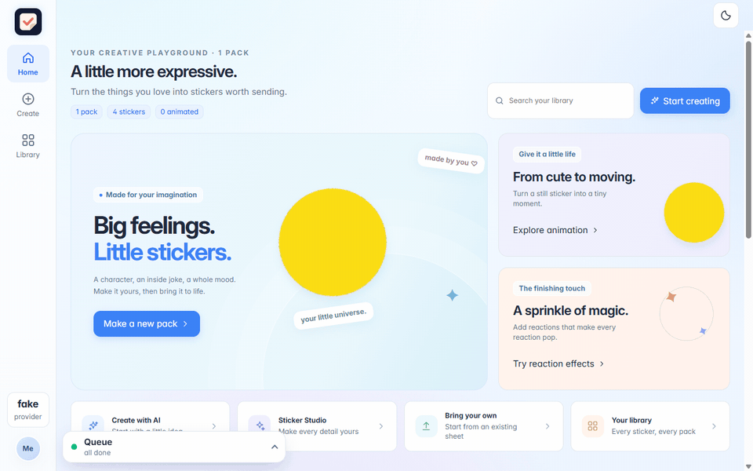
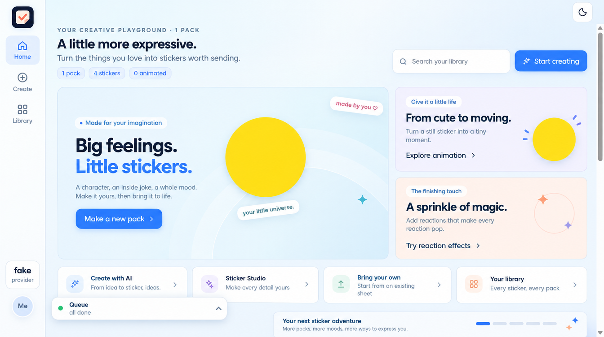
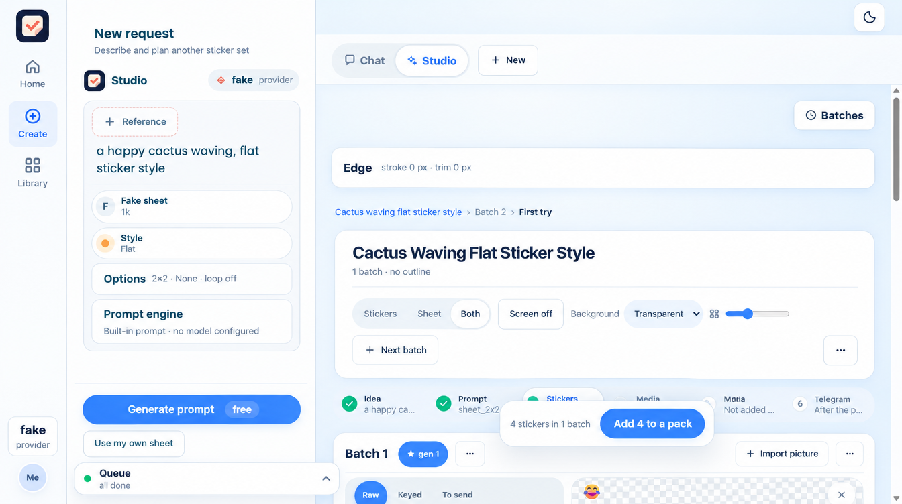
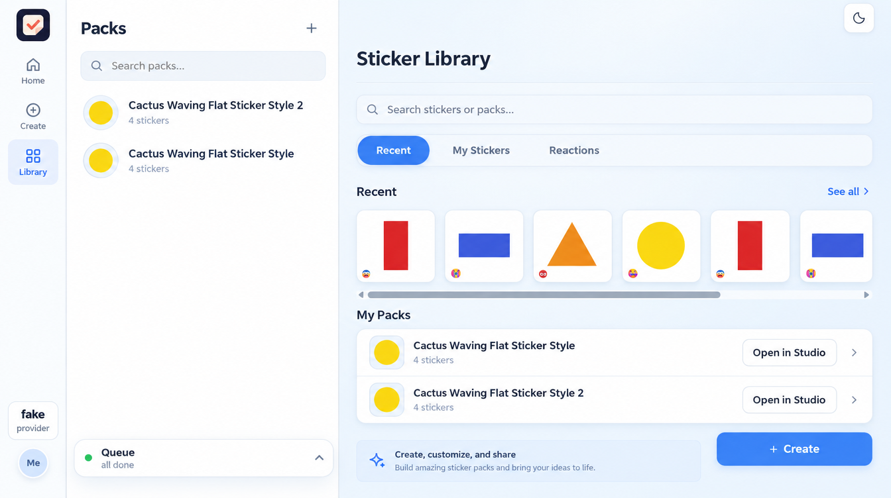
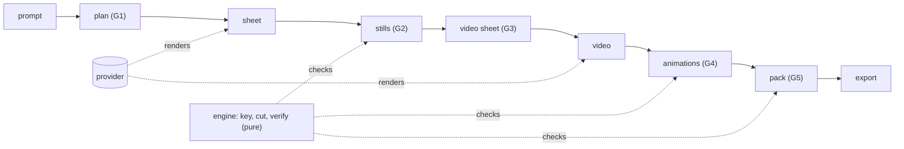

# stickerloom


**Prompt in, verified Telegram sticker pack out.** Local-first, with an offline provider so you can try it with no account and no credits.

[](https://github.com/haitham72/stickerloom/actions/workflows/ci.yml)
[](LICENSE)
[](pyproject.toml)



*Recorded against the offline `fake` provider, which renders deterministic placeholder shapes. Real providers render real art.*

## Screenshots

Enhanced render of the actual UI (light theme, offline `fake` provider).

| Home | Studio | Library |
|---|---|---|
|  |  |  |

## Why

One-off AI images are not sticker packs: Telegram rejects wrong sizes, codecs, durations and missing alpha, and you find out at upload time. stickerloom runs the whole pipeline (prompt, sheet, cut and key, animate, pack) and checks every sticker against Telegram's rules before anything is sent.

## Features

- **Verification gates**: 44 checks in 9 stages (sheet, stills, video, pack), generated into [docs/verification.md](docs/verification.md). Technical failures (Telegram would refuse the file) always block; judgement calls can be overridden with a recorded reason.
- **Approval gates G1-G5** (plan, stills, video sheet, animations, pack): `manual`, `auto` or `off`, per run or globally. See [docs/gates.md](docs/gates.md).
- **Deterministic engine**: key, cut, render and verify are pure numpy/OpenCV; same bytes in, same verdict out.
- **Pluggable providers**: `fake` (offline), `higgsfield`, `openai` (experimental). Paid calls show the price first and respect a daily credit cap.
- **Export and import**: a pack leaves as PNG/WebP plus WebM with a checksummed manifest, and imports back with verify-before-write.
- **Studio UI and HTTP API**: a local web app over the same pipeline.

## Quickstart (offline, no accounts)

Requires Python 3.11+ and `ffmpeg` is bundled via `imageio-ffmpeg`.

```bash
git clone https://github.com/haitham72/stickerloom && cd stickerloom
python -m venv .venv && source .venv/bin/activate     # Windows: .venv\Scripts\Activate.ps1
pip install -e .
export STICKERLOOM_PROVIDER=fake                      # Windows: $env:STICKERLOOM_PROVIDER = "fake"
stickerloom create "a happy cactus" --auto            # builds a verified 2x2 pack
```

Then:

```bash
stickerloom list                                      # packs in the library
stickerloom export <pack-id> --to dir --dest demo     # PNGs + manifest.json
stickerloom import examples/fake_pack                 # the shipped sample pack
stickerloom create "a happy cactus" --auto --grid 3x3 --gates auto
stickerloom serve                                     # Studio at http://localhost:8770
stickerloom doctor                                    # what is installed, what is missing
```

`examples/fake_pack/` is a real output of the offline run: prompt, sheet, stills, a WebM loop and `result.json` with the per-stage record.

## Real providers and Telegram (optional)

```bash
# Higgsfield (default provider): install its CLI, log in, then
unset STICKERLOOM_PROVIDER
stickerloom create "a happy cactus"                   # shows the price and waits for consent

# Telegram send: a bot token from @BotFather
export STICKERLOOM_TELEGRAM_TOKEN="<bot token>"
export STICKERLOOM_TELEGRAM_USER="<your numeric user id>"
stickerloom doctor
```

Details: [docs/providers.md](docs/providers.md), [docs/faq.md](docs/faq.md). Optional extras: `pip install -e ".[agent]"` (chat panel), `[openai]`, `[db]`, `[onnx]`, `[all]`.

## Architecture



Files under `STICKERLOOM_OUT` (default `./out`) are the source of truth; Postgres and Redis are optional mirrors. Layers and rules: [docs/architecture.md](docs/architecture.md).

## Configuration

Every variable is `STICKERLOOM_*` and optional; see [.env.example](.env.example).

| Variable | Default | Purpose |
|---|---|---|
| `STICKERLOOM_PROVIDER` | `higgsfield` | `fake`, `higgsfield` or `openai` |
| `STICKERLOOM_OUT` | `./out` | where runs write their files |
| `STICKERLOOM_GATES` | `manual` | `manual`, `auto` or `off` |
| `STICKERLOOM_DAILY_CREDITS` | unset | cap on paid provider spend per day |
| `STICKERLOOM_TELEGRAM_TOKEN` | unset | bot token for sending packs |

## Development

```bash
pip install -e ".[dev]"
python -m pytest -q tests/test_gates.py
python -m unittest tests.test_export_import tests.test_providers tests.test_verify
python scripts/gen_verify_docs.py                     # regenerate docs/verification.md; fails on drift
```

CI runs the offline quickstart and these core modules ([workflow](.github/workflows/ci.yml)). See [CONTRIBUTING.md](CONTRIBUTING.md) and [SECURITY.md](SECURITY.md).

## Known issues

Some legacy tests still fail from before the rename and the removal of multi-user accounts; they are not hidden and do not touch the offline path. The triage list is in the [CHANGELOG](CHANGELOG.md#known-issues).

## Docs

[architecture](docs/architecture.md) | [providers](docs/providers.md) | [gates](docs/gates.md) | [verification](docs/verification.md) | [API](docs/api.md) | [FAQ](docs/faq.md) | [comparison](docs/comparison.md) | [demo script](docs/demo_script.md) | [launch kit](assets/launch/)

## License

MIT. See [LICENSE](LICENSE); third-party notices in [NOTICE](NOTICE).
