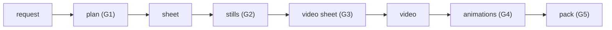

# architecture

How stickerloom is put together: one deterministic engine, a thin provider
layer, one local principal, and two interfaces (the Studio UI and the HTTP
API) over the same golden path.

## the golden path

A request becomes a plan (1–5 tags plus a margin per cell). A provider renders
the plan as a sticker sheet. The engine cuts the sheet into stills and checks
every cell. The approved stills are recomposed onto a video sheet, a provider
animates it, the engine cuts each cell into a looping WebM and checks every
frame, and the approved stickers become a pack that can be sent to Telegram.
A person approves at every gate; Python only blocks what Telegram itself would
reject (the `telegram` and `telegram_set` check stages run before any send).

## layers

| layer | lives in | notes |
|---|---|---|
| Studio UI | `stickerloom/console/ui/` | vanilla JS, one page; the only UI |
| HTTP server | `stickerloom/api/app.py` + `stickerloom/console/server.py` | FastAPI on uvicorn; contract at `GET /api/openapi.json` (see `docs/api.md`) |
| generation | `stickerloom/generation/` | plans, jobs, the provider calls, `model_calls.jsonl` ledger |
| providers | `stickerloom/providers/` | `fake` / `higgsfield` / `openai` behind one `GenerationProvider` shape (see `docs/providers.md`) |
| engine | `stickerloom/engine/` | pure: key, cut, render, video, verify — never imports a model client, never spends (see `docs/verification.md`) |
| flow | `stickerloom/flow/` | the lifecycle: `pipeline.py`, `gates.py` (G1–G5), imports, problems, purge |
| media | `stickerloom/media/` | the Library: packs, cutout, export names |
| services | `stickerloom/services/` | Telegram send (`telegram.py`), local/cloud language models |
| vision | `stickerloom/vision/` | a pre-reviewer only: it never approves; without configuration stickers stay "unjudged" |
| store / runtime | `stickerloom/store/` + `stickerloom/runtime/` | Postgres mirror (optional), files, names, atomic writes |

Rules that hold across the layers:

- **Files are the truth, Postgres mirrors them.** `out/G###/result.json` is the
  record of a batch; `store/sync.py` mirrors it to Postgres when a database is
  configured. The default install runs with neither Postgres nor Redis.
- **One local principal.** Every caller is `id="local"` (`stickerloom/runtime/principal.py`).
  There are no accounts, no per-person credits, no pricing, no support queue.
- **Paid calls are explicit.** Every provider call is a line in
  `out/model_calls.jsonl`; the price is shown before anything is spent and the
  daily cap `STICKERLOOM_DAILY_CREDITS` is enforced in `generation/jobs.py`.
- **Names are code, not hand-built paths.** Batch and job folders carry labels;
  outputs resolve through `pipeline.gen_dir`, `pipeline.out_path` and
  `jobs.job_dir` — never string concatenation.

## where the data lives

| place | what | owner |
|---|---|---|
| `inputs/` | prepared sheets, `img-NNN-<subject>/` (never renamed) | `flow/sources.py` |
| `out/G###[-label]/` | one batch: `result.json`, `source/`, `slices/`, `video_sheet/` | `flow/pipeline.py`, `flow/gates.py` |
| `out/jobs/J###[-label].json` | one provider job, written at `claim` before waiting | `generation/jobs.py` |
| `out/tasks/` | the external task id of every request | `generation/tasks.py` |
| `out/library/` | packs and their sticker copies | `media/library.py` |
| `out/problems.jsonl` | one record per problem (`open_auto` keeps its signature) | `flow/problems.py` |
| `out/model_calls.jsonl` | every provider or model call | `generation/model_calls.py` |
| `out/trash/` | removed batches and deleted packs, restorable until purged | `flow/batches.py`, `flow/purge.py` |

## engine

Deterministic dict/dataclass/JSON (`stickerloom/engine/`); thresholds live in
`EngineConfig` only. A test (`tests/test_engine.py`, `test_engine_boundary`)
fails if the engine ever imports a web framework, a database driver, an agent
library or a model client.

- **Stills** — grid-cut (`grid.py`) + per-cell border-ring chroma key, one
  pack-wide median scale, 512 px RGBA with a white outline. Grid default 2x2;
  explicit 3x3 and 1x1 stay supported.
- **Video** — decode cell by cell (ffmpeg), loop close by retiming plus a
  short crossfade, VP9 with alpha down a quality ladder to 256 KB.
- **Verifier** — 44 checks in 9 stages (`docs/verification.md`, generated by
  `scripts/gen_verify_docs.py`): `sheet`, `still`, `slot`, `video_sheet`,
  `video`, `anim`, `pack`, `telegram`, `telegram_set`.
- **Gates** (`flow/gates.py`) — G1 plan -> G2 stills -> G3 video sheet -> G4
  animations -> G5 pack. Technical failures are final; judgement failures carry
  a recorded "Use it anyway" override that later cuts keep. Rejection never
  deletes; a sticker keeps its number through every stage.
- **Telegram** (`services/telegram.py`) — the verifier's `telegram` stages
  judge before any network call (video: WebM VP9 + alpha, 512-side, 256 KB;
  static: PNG/WebP + transparency; 1–120 stickers, emoji each, set name ending
  `_by_<bot>`). The token comes from `STICKERLOOM_TELEGRAM_TOKEN` and is never
  returned or logged. Only generated raster art ships as WebM/PNG/WebP; the
  vector Lottie format is for Lottie-sourced reactions only.
- **Imports** (`flow/imports.py`) — a prepared sheet becomes a normal batch
  through the same engine; a prepared video attaches grid-matched. The
  zero-credit path.

## interfaces

The product is the API; the Studio demonstrates it. Every feature is an engine
function plus a stable JSON contract first, a screen second. The optional chat
agent (`stickerloom[agent]` extra) reuses the Studio's own engine; without the
extra installed, the chat panel shows an install hint and never crashes.
